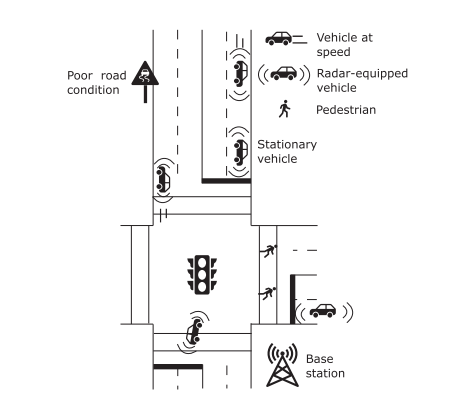
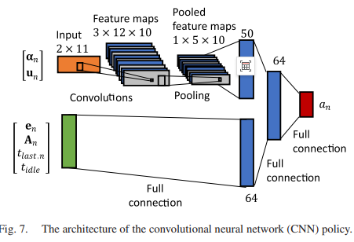
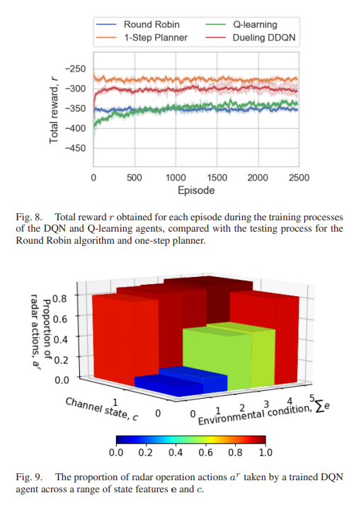
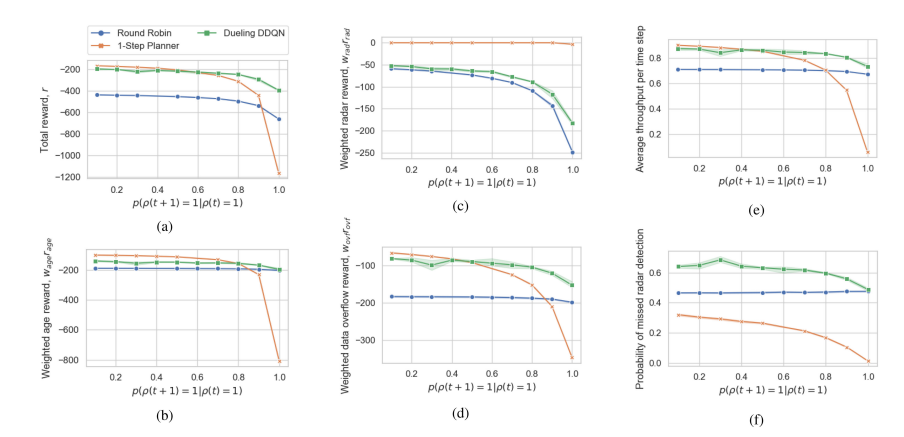
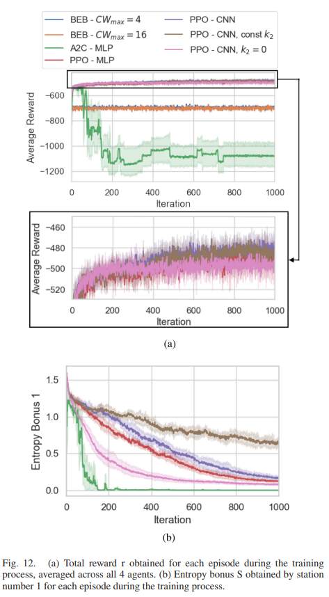

# ISAC: Joint Radar - Communication Scheduling Research Based on Deep Multi-Agent Reinforcement Learning [with Python code]

The radar detection and communication are two fundamental subtasks for the operation of next-generation autonomous vehicles (AVs). The upcoming widespread adoption of millimeter wave technology in faster 5G networks has raised concerns about interference from vehicle radar sensors, leading to a series of studies on Joint Radar - Communication (JRC). This paper considers the time-sharing issue of JRC while aiming to minimize the average age of information transmission (AoI) for autonomous vehicles equipped with JRC. It first formulates this problem as a Markov Decision Process (MDP), then proposes a more general multi-agent system that incorporates an appropriate Medium Access Control (MAC) protocol, representing it as a Partially Observable Markov Game (POMG). To address the POMG problem, a multi-agent extension of the Proximal Policy Optimization (PPO) algorithm is proposed, incorporating an algorithmic feature from reinforcement learning from raw observations. Simulations using a range of environmental parameters are conducted to simulate real-world operational variations. The results indicate that the selected deep reinforcement learning method enables agents to achieve good performance even with minimal prior knowledge of the environment.
Introduction: Future autonomous vehicles must perform numerous tasks to achieve their ultimate goal of safe navigation, including perception, localization, obstacle mapping, and path planning. In collaborative driving environments, there is a need to transmit a large amount of data, which can occur between vehicles (V2V) or between vehicles and infrastructure (V2X). With the commercialization of 5G communication technology and the application of higher frequency (such as millimeter wave bands) data transmission, there is a possibility of interference between radar waves and communication signals.
The problem of jointly operating radar and communication functions within the same frequency range is known as Joint Radar - Communication (JRC) or Communication and Radar Spectrum Sharing (CRSS). Methods for implementing JRC systems have been reviewed in related research, generally falling into three categories: utilizing communication signals for target detection, modulating communication signals onto radar pulses, and time-division multiplexing between radar and communication operations.
The traditional method for time-division multiplexing (TDM) employs fixed scheduling to alternate radar and communication operations. In contrast, there is research proposing a learning-based approach for autonomous vehicles, where the main advantage is that the communication system can learn to respond to instantaneous changes in environmental conditions, which may necessitate more frequent radar operation to support safe navigation.
Another challenge for data communication in autonomous vehicles is the need for high data rates and fresh sensory information for safe navigation, while the onboard entertainment system requires low latency internet connectivity. Autonomous vehicles typically come equipped with a set of sensors to reliably perceive their surroundings, including cameras, lidar, radar, ultrasonic sensors, INS, and satellite-based positioning systems (such as GPS). Due to the multidimensional nature of external sensors, they generate a significant amount of data. In collaborative driving environments, this data may need to be transmitted in real-time to other vehicles or infrastructure.
Traditional performance metrics for data communication, such as throughput or latency, might be useful for onboard entertainment systems, but in scenarios requiring immediate responses, metrics for evaluating sensory data communication performance may not be sufficient. Research has shown that even small delays in packets containing outdated information can have low utility. In automotive environments, an indicator better suited for assessing communication timeliness is the Information Age (AoI), defined as the duration since the last received packet.
This paper considers a combined approach that jointly minimizes AoI by TDM and maintains the timely operation of radar while considering both single-agent and multi-agent scenarios. Key considerations driving problem formulation and solution approaches include:
Environmental perception: The agent must be able to adjust its radar usage based on situations where radar becomes more important.
Urgency dependence: Autonomous vehicles may transmit several types of data. The JRC system should be able to prioritize more important data transmissions.
Low prior knowledge: The JRC system needs minimal prior knowledge about the vehicle's environment, the operational system it is running on, and the nature of the data it is transmitting.
Distributed execution: After training, vehicles in a multi-agent environment should be able to make decisions in a distributed manner.
This paper presents significant improvements and extensions to the previously proposed JRC method based on time-division multiplexing, with the main contributions as follows:
A framework for managing multiple data queues for individual vehicle agents, where each type of data represents packets of data at different urgency levels. This problem is formulated as a Markov Decision Process (MDP).
A deep reinforcement learning-based time-division multiplexing method for training agents to coordinate radar operations and minimize the AoI of transmitted data.
A more general multi-agent system is described to simulate real-world vehicle communication scenarios. The problem is transformed into a Partially Observable Markov Game (POMG), an extension of MDP.
A MAC technology that combines multi-agent deep reinforcement learning methods to train agents within a multi-agent system.
Article illustrations
Conclusion This paper investigates the joint radar - communication (JRC) problem for autonomous driving vehicles, aiming to jointly optimize radar operation and information age (AoI) of multiple data queues through finding real-time time-division multiplexing strategies. By reviewing contemporary literature on automotive sensors and perception, combined with modern understanding of road traffic safety, the paper determines how the JRC scheduling strategy module can be integrated into a vehicle perception system and how to schedule radar sensing effectively to support road safety objectives. The problem is formulated as a Markov Decision Process (MDP), and a Generalized Partially Observable Markov Game (POMG) for systems containing multiple distributed vehicles constrained by a medium access protocol is proposed. Theoretical analysis is conducted, and the MDP and POMG problems are solved using deep reinforcement learning.
Experimental results show that the selected deep reinforcement learning method, despite having minimal knowledge of environmental information, still outperforms all baseline algorithms. The findings also reveal two insights: firstly, the proposed convolutional neural network (CNN) architecture is more effective in extracting features from raw representations of data queues; secondly, entropy regularization enables agents in POMG to achieve better performance by exploring state-action space more effectively. Future work may consider methods for implicit learning to adapt to changing environmental parameters, which could include more realistic communication request bursts and more complex channel condition changes.

## Images

<!-- PAYMENT_BLOCK -->

## Get this dataset

- Payment link (Stripe): [Buy now](https://buy.stripe.com/3cs8yP7sY87d0vu9AB)
- Payment QR code: 

<!-- /PAYMENT_BLOCK -->
